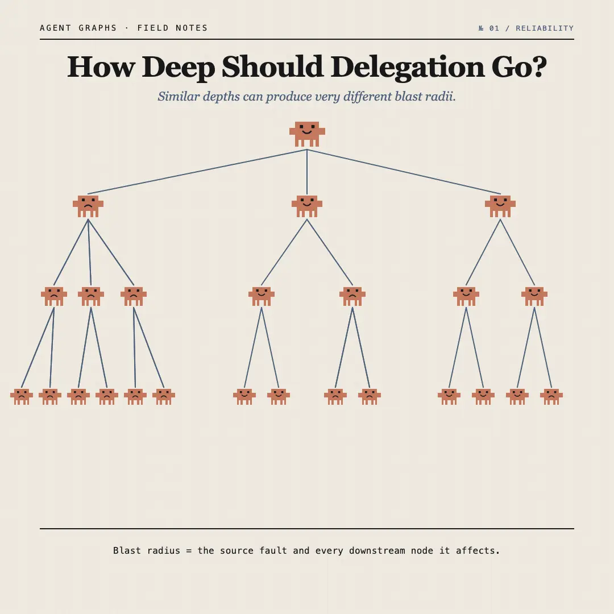

An agent error costs as much as the work built on top of it. Each agent can do its task correctly and the system can still fail: a mis-framed problem early on becomes a premise for every agent that follows.

**Blast radius** is the faulty node plus every downstream node it affects. Depth limits miss it: the figure shows three faults at uniform depth reaching ten agents, three, and one.

<figure class="post-figure">
  
  <figcaption>Similar depths can produce very different blast radii.</figcaption>
</figure>

The rule:

- Estimate how much of the workflow fails if an output is wrong.
- High-radius outputs carry sources and pass an independent check before others use them.
- Narrow, easily tested tasks can be delegated freely.
- Stop once the parent can no longer inspect the evidence or test the result.

Which outputs do you verify before other agents build on them?
