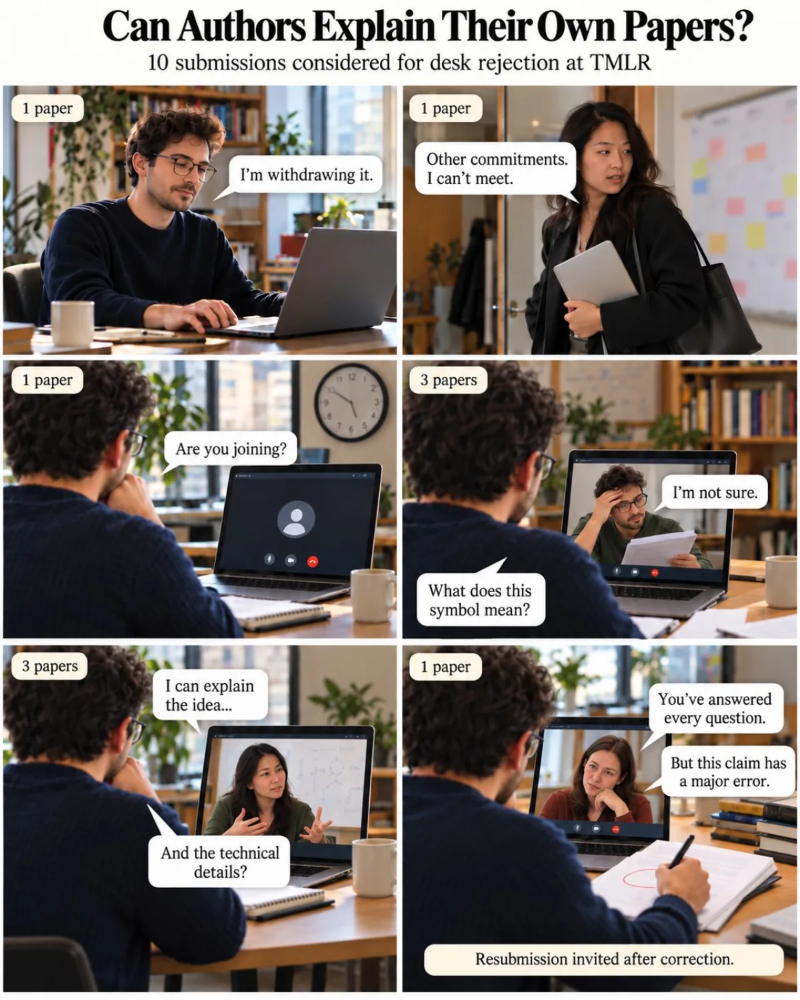

Nihar B. Shah, one of the editors-in-chief of *Transactions on Machine Learning Research* (TMLR), invited the authors of ten submissions slated for desk rejection to talk about their work.

<figure class="post-figure">
  
</figure>

The outcomes:

- One submission was withdrawn.
- One author said they were unavailable.
- One author did not join the meeting.
- The authors of three submissions could not answer basic questions.
- The authors of three submissions explained the general idea but struggled with the technical details.
- The authors of one submission answered every question, but a serious error was found in one of the paper's main claims.

All ten were rejected. The authors who answered every question and acknowledged their error were allowed to resubmit once the corrections are complete.

Whether a process that takes 20 to 25 hours is practical is open to debate. These were also submissions already selected for rejection, so the results should not be generalized to all authors, and not attending a meeting is not proof of ignorance.

A researcher can master their work and still make mistakes. Authorship requires being able to explain the choices made, show the evidence behind them, and take responsibility for weighing and correcting an error when it is criticized.

The same standard applies to LLM-assisted research. This case does not show that the problems came from LLM use. But having a tool produce the text, the code or part of the analysis does not remove the responsibility to check that they are correct.

Evidence records, citation checks, hooks and reproducibility tests can support this process. The technical command to judge what these checks test, what they leave open, and whether the results actually support the claims is still required.

Source: [Asking authors about their own papers](https://blog.tmlr.org/2026/asking-authors-about-their-own-papers/) (TMLR blog).
