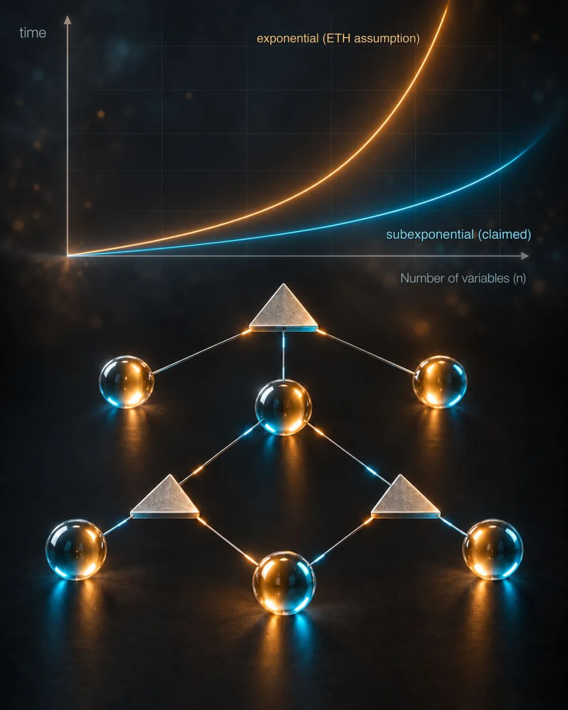

OpenAI and Anthropic have each published an AI-generated proof that the **Exponential Time Hypothesis (ETH)** is false.

<figure class="post-figure">
  
</figure>

ETH holds that 3-SAT, deciding whether true/false values can satisfy a set of three-variable logical rules, needs exponential time in the worst case. Both papers give deterministic algorithms that run in subexponential time. That is still not polynomial: P vs NP remains open, and nothing here is fast in practice.

The larger consequence is for the literature. Hundreds of papers derive lower bounds conditionally on ETH, and those bounds now need re-examination. Both proofs are formalized in Lean, and independent review is under way. Until it concludes, these remain claims.

- OpenAI: [The Exponential Time Hypothesis is False](https://github.com/openai/math/blob/main/preprints/The-Exponential-Time-Hypothesis-is-False-October-25-2026/paper.pdf)
- Anthropic: [hexagonmath.org/2610.00577v1](https://hexagonmath.org/2610.00577v1)
