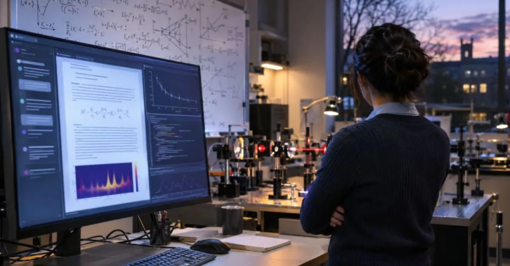

Can AI agents carry out physics research from start to finish? A new benchmark says not yet.

<figure class="post-figure">
  
</figure>

In **FrontierPhysics**, 42 physicists turned their own research into 56 tasks across nine physics domains. In each task, the agent works like a PhD student. It reviews the literature, plans, runs experiments and writes a manuscript. Deterministic tests check whether the results are correct. Expert rubrics check whether the paper is publishable.

The results:

- 22 models, 26 configurations, 4,364 rollouts
- No configuration passed more than 30%
- The best, Claude Opus 5.5, passed 46 of 168 rollouts (27.4%)
- The authors' own papers scored 96.2% on average under the same rubrics

The failure analysis stands out. Agents rarely fail for lack of physics knowledge or because of coding errors. They fail because their "reasoning is not rigorous enough." A typical case is circular self-verification: the agent checks a result against another result it produced itself. The second main gap is missing expert intuition.

The method is also worth noting. Experts reviewed all 168 GPT-6 Astra rollouts by hand and found nine that had been wrongly marked as failures. Good benchmarks take domain expertise and time.

Paper: [arxiv.org/html/2611.06910v1](https://arxiv.org/html/2611.06910v1)
