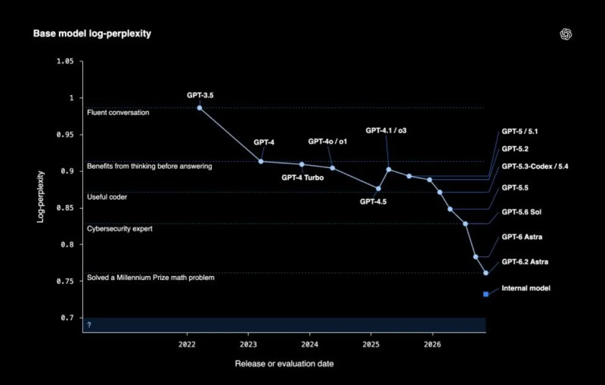

When we teach cross-entropy to engineering students, we start with Shannon. The better you predict a source, the fewer bits you need to encode it.

On November 22, OpenAI's chief scientist Jakub Pachocki proposed the same quantity as a shared threshold for AI safety. OpenAI also published its internal pretraining curve for the first time. On the company's own internal code dataset, the reported log-perplexity values are:

- GPT-3.5: about 0.99
- GPT-4: about 0.91
- Below 0.8: a marked jump in cybersecurity and mathematics capabilities
- About 0.76: first solutions to open math problems OpenAI had posed to its models for over a year
- Next expected window: 0.68–0.70

<figure class="post-figure">
  
  <figcaption>OpenAI's published base-model log-perplexity curve, measured on its internal code dataset.</figcaption>
</figure>

The proposal: frontier labs agree on a common perplexity limit, and do not cross it until a concrete safety milestone is met.

It is rare for a company to put competitively sensitive data on the table. Still, as an engineer, I have two questions.

The first is about **measurement**. These values come from OpenAI's own dataset. Losses measured on different datasets cannot be compared. Without a shared held-out test set that no lab has trained on, the proposed limit stays an internal target of one company.

The second is about **scope**. The essay itself admits that gains from chain-of-thought reasoning do not lower perplexity. In my view, the same holds for search-based methods such as tree of thoughts, and for inference-time compute in general. A lab could keep pretraining at the limit and still raise capability at inference time.

Shannon's quantity may make a good thermometer. To use it as a thermostat, everyone first has to measure in the same room.

Source: [Perplexity and intelligence](https://openai.com/index/perplexity-and-intelligence/) (OpenAI).
